# BITEM at the NTCIR-19 R2C2 Task: Predicting Confidence from Agentic RAG Pipeline Signals

Code and submitted runs for the paper by Julien Knafou, Luc Mottin, Alexandre Flament, Paul van Rijen, Esteban Gaillac and Patrick Ruch (HES-SO and SIB Swiss Institute of Bioinformatics, Geneva), [arXiv:2609.37993](https://arxiv.org/abs/2609.37993). The slides of a talk on this work, with the pipeline and the results animated, are at [jknafou.github.io/epfl-r2c2](https://jknafou.github.io/epfl-r2c2/).

## Abstract

The BITEM team entered both subtasks of the NTCIR-19 R2C2 task with a single agentic pipeline, in which a model searches, reads and records evidence over a movie corpus while an orchestrator holds the record and rules on what may be submitted. A claim is admitted only once an entailment cascade has checked it against the passage it cites, and an answer is released only once enough checked evidence stands behind it. Each question is run three or four times, every pass retrieving from a corpus stripped of what the earlier passes have already seen. The confidence score predicted with each answer is computed by the orchestrator from what the run leaves behind and is never asked of the model, which is offered no way to rate itself. The two retrieval runs placed 4th and 5th of 22, pooling the passes was worth 0.0709 nDCG@20, and the gain was largest on the multi-hop and post-processing-heavy questions, where the organisers rank the pooled run top of the field. Sixteen of the 25 answer runs were built on passages these two runs supplied, 12 of them submitted by other teams. HMR rewards a system whose confidence is high where it answers right and low where it answers wrong. The pipeline reached an accuracy of 0.9219, 6th of 25, while the confidence scores predicted for those answers gave an HMR of 0.4915, 13th. A few rules crafted over those same recorded signals, with no further model call and no further retrieval, raise that to an accuracy of 0.9375, 5th, and an HMR of 0.6985, 9th. Ranking on HMR alone can reward a system for answering wrongly with low confidence, so we propose accHMR, the accuracy multiplied by HMR, which reports the reward in proportion to the accuracy, and on which the revised rules would have scored 0.6549, 5th. For future work, fitting a model on the numbers the pipeline already produces, rather than writing such rules by hand, would be a real step forward.

## Method

A single language model answers each question by searching the indexed corpus, reading passages and recording claims quoted from them, while an orchestrator outside the model executes its tool calls, checks each claim against its passage with an entailment cascade, and accepts an answer only once enough checked evidence supports it. Each question is run three or four times, every pass searching a corpus from which the passages earlier passes have seen are removed, and the confidence given with an answer is computed by the orchestrator from what the passes recorded. Figure 1 draws this loop, from what the model proposes to what the orchestrator rules.

<picture><source media="(prefers-color-scheme: dark)" srcset="docs/figures/talk/pipeline-dark.gif">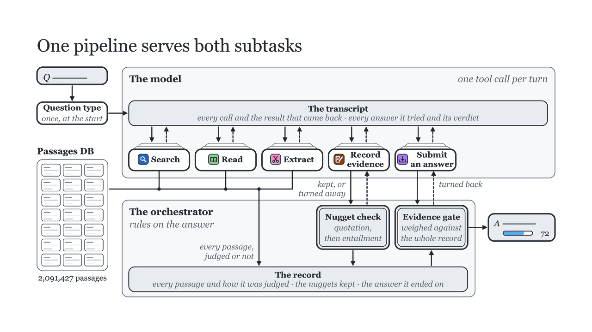</picture>

Figure 1, from the talk. The model sees a transcript of every call it made and every result it received, and makes one tool call per turn. Retrieval reads the 2,091,427 passages through a sparse and a dense index, drawn here as one store. The orchestrator checks each claim the model records against the passage it quotes, first that the quotation is there and then that the passage entails the claim, and weighs each submitted answer against everything the pass has recorded, turning it back to the model or releasing it. Five of the eight tools are drawn: `search_entities`, `list_nuggets` and `flag_nugget_bogus` are left out, and the number on the answer is illustrative. The figure as printed in the paper is [docs/figures/pipeline.svg](docs/figures/pipeline.svg).

One question, *In Star Wars, on which planet did Han Solo die?*, followed through its first pass, step by step as in slide 4 of the talk ([jknafou.github.io/epfl-r2c2/#/4](https://jknafou.github.io/epfl-r2c2/#/4)):

<details>
<summary>Han Solo's first pass, in twelve steps</summary>

<picture><source media="(prefers-color-scheme: dark)" srcset="docs/figures/talk/han-solo-01-dark.gif">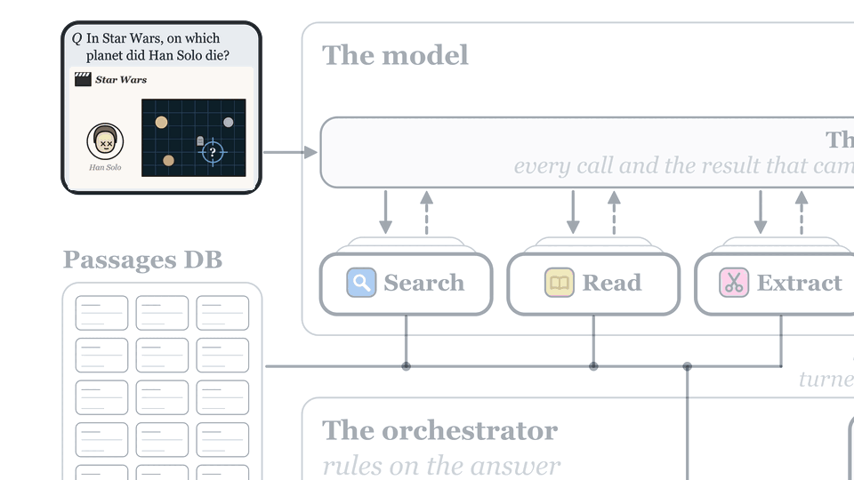</picture>

**Step 1.** The question is typed into the pipeline's question box.

<picture><source media="(prefers-color-scheme: dark)" srcset="docs/figures/talk/han-solo-02-dark.gif">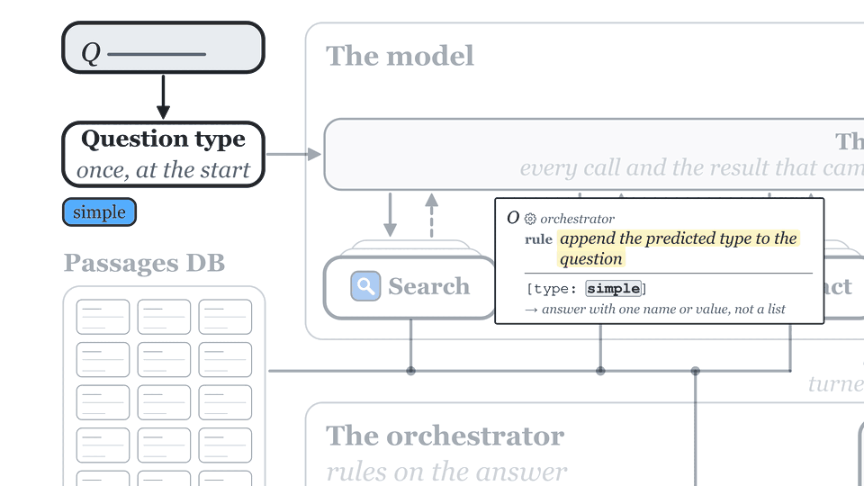</picture>

**Step 2.** Its type is predicted once, here *simple* (the organisers class it as multi-hop), and the orchestrator appends it to the question with the answer format that type asks for.

<picture><source media="(prefers-color-scheme: dark)" srcset="docs/figures/talk/han-solo-03-dark.gif">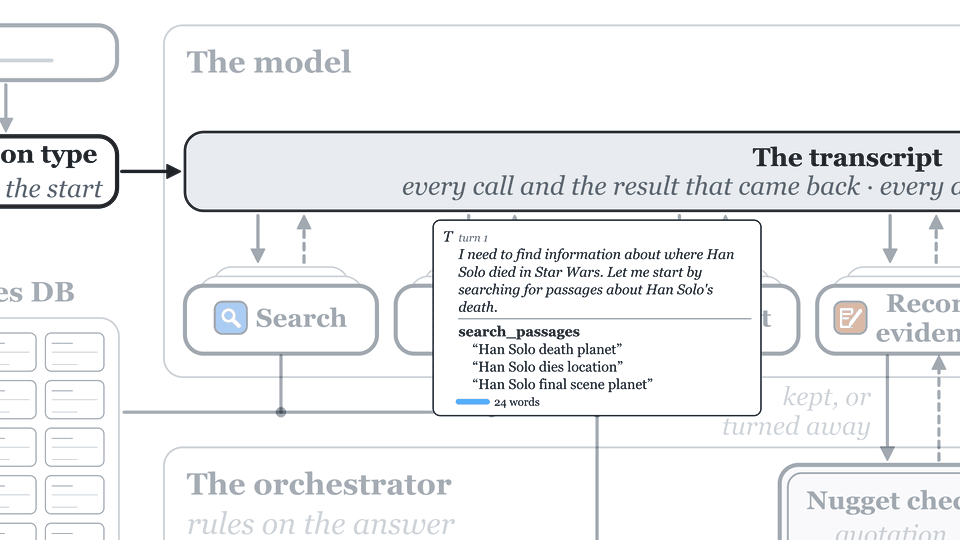</picture>

**Step 3.** Turn 1: the model calls `search_passages` with three queries.

<picture><source media="(prefers-color-scheme: dark)" srcset="docs/figures/talk/han-solo-04-dark.gif">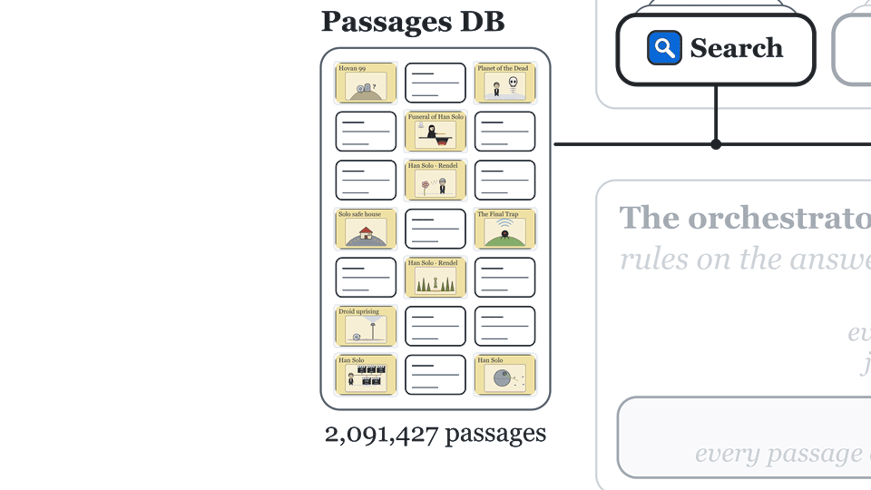</picture>

**Step 4.** The search returns ten passages from the store.

<picture><source media="(prefers-color-scheme: dark)" srcset="docs/figures/talk/han-solo-05-dark.gif">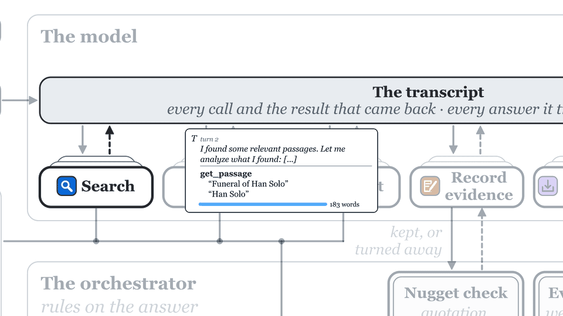</picture>

**Step 5.** Turn 2: the model calls `get_passage`.

<picture><source media="(prefers-color-scheme: dark)" srcset="docs/figures/talk/han-solo-06-dark.gif">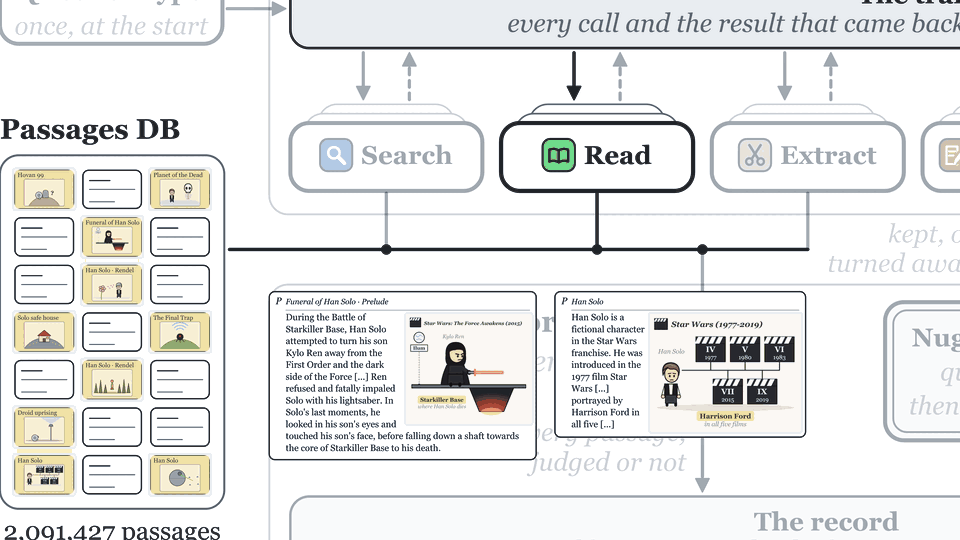</picture>

**Step 6.** The two passages it reads.

<picture><source media="(prefers-color-scheme: dark)" srcset="docs/figures/talk/han-solo-07-dark.gif">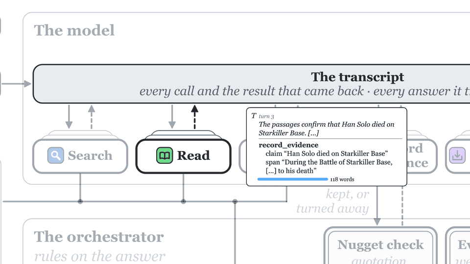</picture>

**Step 7.** Turn 3: the model calls `record_evidence`.

<picture><source media="(prefers-color-scheme: dark)" srcset="docs/figures/talk/han-solo-08-dark.gif">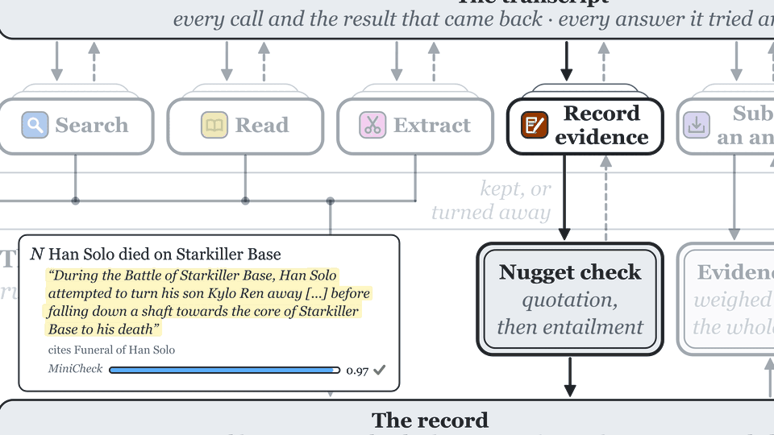</picture>

**Step 8.** The nugget check finds the quotation in its passage and the passage entails the claim, at 0.975: the nugget is kept in the record.

<picture><source media="(prefers-color-scheme: dark)" srcset="docs/figures/talk/han-solo-09-dark.gif">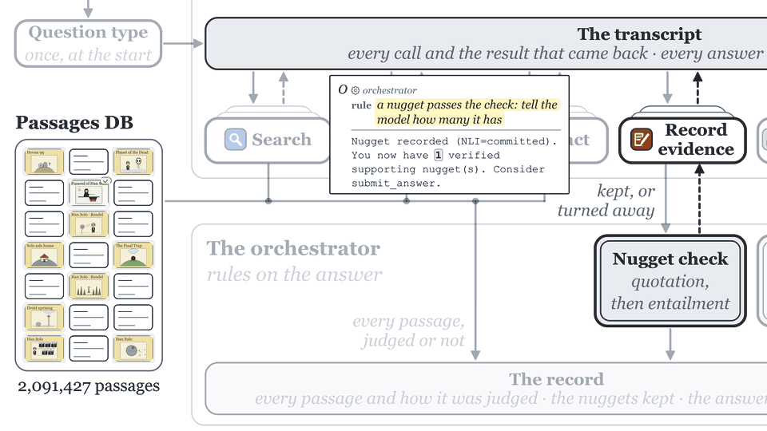</picture>

**Step 9.** The orchestrator tells the model how many supporting nuggets it now has, and the passage that supports the nugget is marked.

<picture><source media="(prefers-color-scheme: dark)" srcset="docs/figures/talk/han-solo-10-dark.gif">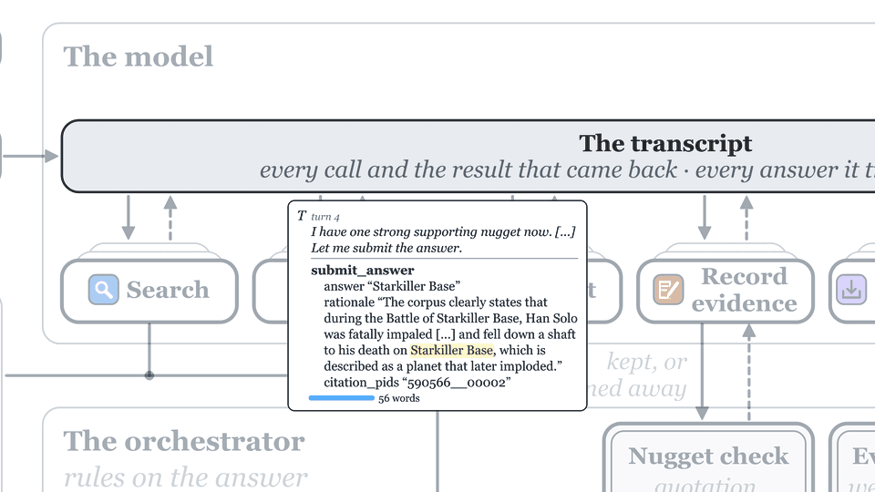</picture>

**Step 10.** Turn 4: the model calls `submit_answer`, with its answer, rationale and citation.

<picture><source media="(prefers-color-scheme: dark)" srcset="docs/figures/talk/han-solo-11-dark.gif">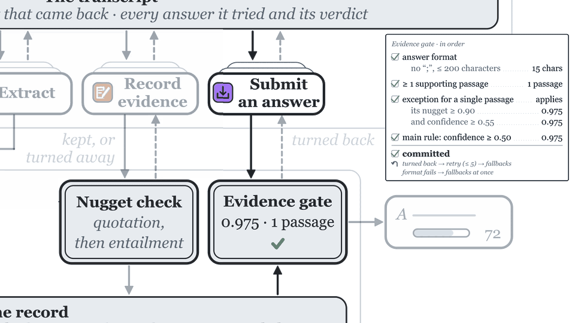</picture>

**Step 11.** The evidence gate checks the answer in order: its format, at least one supporting passage, the single-passage exception, the main rule, then commits it. The talk derives the confidence on this step too, and that part is left out here; the paper says how the confidence is computed.

<picture><source media="(prefers-color-scheme: dark)" srcset="docs/figures/talk/han-solo-12-dark.gif">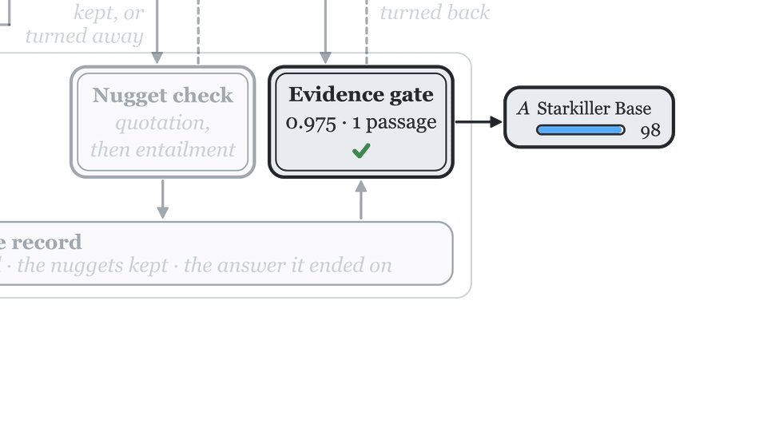</picture>

**Step 12.** The answer leaves the gate: *Starkiller Base*. It is wrong, and later passes answer *Ilum*.

</details>

## Results

All scores are over the 64 scored questions. Question 0025 was reissued by the organisers after release, so 65 were answered and 64 are scored.

### Passage retrieval

Table 1 of the paper, under the organisers' consolidated direct qrels. W/T/L counts the questions on which the pooled run scores higher than, the same as, and lower than the single-pass run.

| | PG-1, single pass | PG-2, pooled | Δ | W/T/L |
| --- | --- | --- | --- | --- |
| nDCG@20 | 0.3509 | 0.4217 | +0.0709 | 42/7/15 |
| Q@20 | 0.2677 | 0.3582 | +0.0905 | 41/7/16 |

Table 2, nDCG@20 by question type:

| question type | n | PG-1 | PG-2 | Δ | W/T/L |
| --- | --- | --- | --- | --- | --- |
| simple | 26 | 0.3034 | 0.3608 | +0.0574 | 14/6/6 |
| simple w/ condition | 7 | 0.2888 | 0.3403 | +0.0515 | 6/0/1 |
| comparison | 7 | 0.4168 | 0.4392 | +0.0223 | 5/0/2 |
| aggregation | 7 | 0.4498 | 0.4859 | +0.0361 | 4/0/3 |
| multi-hop | 10 | 0.3749 | 0.4747 | +0.0998 | 7/0/3 |
| post-processing-heavy | 7 | 0.3900 | 0.5725 | +0.1824 | 6/1/0 |

### Answering with confidence

Table 3, our three official runs. The organisers define acc, R_O, R_U, HMR and avconf; accHMR is accuracy times HMR.

| | acc | R_O | R_U | HMR | avconf | accHMR |
| --- | --- | --- | --- | --- | --- | --- |
| AC-1, single pass | 0.9062 | 0.1633 | 0.8102 | 0.2719 | 0.8127 | 0.2464 |
| AC-2, most confident | 0.9219 | 0.3460 | 0.8483 | 0.4915 | 0.8331 | 0.4531 |
| AC-3, summed agreement | 0.8906 | 0.2471 | 0.9904 | 0.3956 | 0.9644 | 0.3523 |

Figure 2, the confidence AC-2 submitted for each question, green where the answer was judged correct and red where it was not:


### Additional runs

Table 4, the recovered model-as-judge run and two runs rebuilt by rule from the signals the pipeline had already recorded, with no further model call and no further retrieval:

| | acc | R_O | R_U | HMR | avconf | accHMR |
| --- | --- | --- | --- | --- | --- | --- |
| model as judge (recovered run) | 0.9375 | 0.1750 | 0.9430 | 0.2952 | 0.9356 | 0.2768 |
| single pass, longest deliberation | 0.9062 | 0.8333 | 0.5517 | 0.6639 | 0.5156 | 0.6017 |
| four passes, independent agreement | 0.9375 | 0.6250 | 0.7917 | 0.6985 | 0.7656 | 0.6549 |

Figure 3, accuracy against HMR for every answer run of the task, ours in black (white on a dark page) and the rebuilt ones hollow:

<picture><source media="(prefers-color-scheme: dark)" srcset="docs/figures/talk/ac-runs-dark.gif">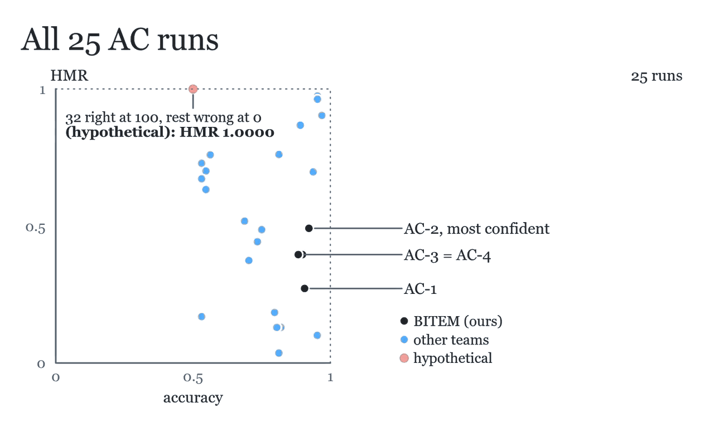</picture>

Figure 3, from the talk. The two hollow rings are the rebuilt runs of Table 4, labelled by their files in `submission/unofficial/`: `revised-longest-deliberation` is the single pass, longest deliberation, and `revised-independent-agreement` the four passes, independent agreement. Each leaves the submitted run whose passes it re-scores, AC-1 and AC-2, and rises in HMR while its accuracy barely moves. The point at an accuracy of 0.5 and an HMR of 1 is hypothetical: a run answering 32 questions right at confidence 100 and the other 32 wrong at 0 would score a perfect HMR (it is labelled k = 32 once the field is flattened). The field then flattens onto HMR alone, where the four-pass rebuilt run is 9th, and onto accuracy alone, where it is 5th: the two are scored independently, and several runs reach a high HMR at an accuracy near one half. It then turns into three dimensions with accHMR, accuracy times HMR, as the height, and flattens onto that axis, where the hypothetical run falls to 0.5000 and the four-pass rebuilt run stands 5th of the 25 runs. The axis then shows each team's best run alone, where it would stand 2nd of 7. That team view is the talk's, not the paper's, which ranks runs, and its seven teams count the organisers' baseline runs as one. The rules behind the rebuilt runs were designed on the same 64 questions they are scored on. The figure as printed in the paper is [docs/figures/composite-shapes.svg](docs/figures/composite-shapes.svg).

## Reproduce

The environment is managed with [uv](https://docs.astral.sh/uv/) on Python 3.12. The analysis scripts use only the standard library.

```bash
uv sync --frozen    # the full environment; the pipeline itself expects Linux with CUDA
uv run pytest       # the unit tests
```

The numbers are computed from our runs in `submission/` and from the organisers' result files: the qrels, the per-run evaluation files, the gold answers and `official.AC.csv`. Those files are the organisers' to distribute. Obtain them from the NTCIR-19 R2C2 organisers and place them under `results/`, so that `results/OfficialResults/official.AC.csv` and `results/r2c2topics-and-goldanswers.xlsx` exist.

[analysis/README.md](analysis/README.md) gives, for every table, figure and number of the paper, the command that reproduces it.

## Repository

| Folder | Contents |
| --- | --- |
| `submission/` | Our official runs as submitted, with their checksums (`pr-2026-04-25/`, `ac-2026-05-15/`), and the three unofficial runs of Table 4 (`unofficial/`). See [submission/README.md](submission/README.md). |
| `analysis/` | The scripts behind the paper's tables, figures and numbers, and the tables they read. See [analysis/README.md](analysis/README.md). |
| `src/r2c2_agent/` | The system that answers the questions: the agent loop with its prompts and clients (`src/r2c2_agent/agent/`), the orchestrator and worker, the retrieval server, the entailment checks, the answer aggregation and the scheduler scripts. |
| `src/r2c2_index/` | Corpus parsing, entity annotation, sparse and dense indexes. See [src/r2c2_index/README.md](src/r2c2_index/README.md). |
| `scripts/` | Corpus and topic download, and the pipeline stages in order. |
| `docs/figures/` | The sources of the paper's three figures, and in `talk/` the two animations cut from the talk, with where each came from in `talk/SOURCES.txt`. |
| `tests/` | Unit and integration tests. |

## Notes

- This code was refactored out of a larger project for this release. It is not exactly the code that produced the runs, so some mistakes may remain, and we apologise for any you find.
- The fourth answer run we submitted, BITEM-AC-4, is a byte copy of BITEM-AC-3, made by a mistake the day before the deadline. The run it should have been, the model as judge, is `submission/unofficial/model-as-judge.AC`.

## Citation

```bibtex
@misc{knafou2026bitemntcir19r2c2task,
      title={BITEM at the NTCIR-19 R2C2 Task: Predicting Confidence from Agentic RAG Pipeline Signals},
      author={Julien Knafou and Luc Mottin and Alexandre Flament and Paul van Rijen and Esteban Gaillac and Patrick Ruch},
      year={2026},
      eprint={2609.37993},
      archivePrefix={arXiv},
      primaryClass={cs.CL},
      url={https://arxiv.org/abs/2609.37993},
}
```

## Licence

MIT. See [LICENSE](LICENSE).
